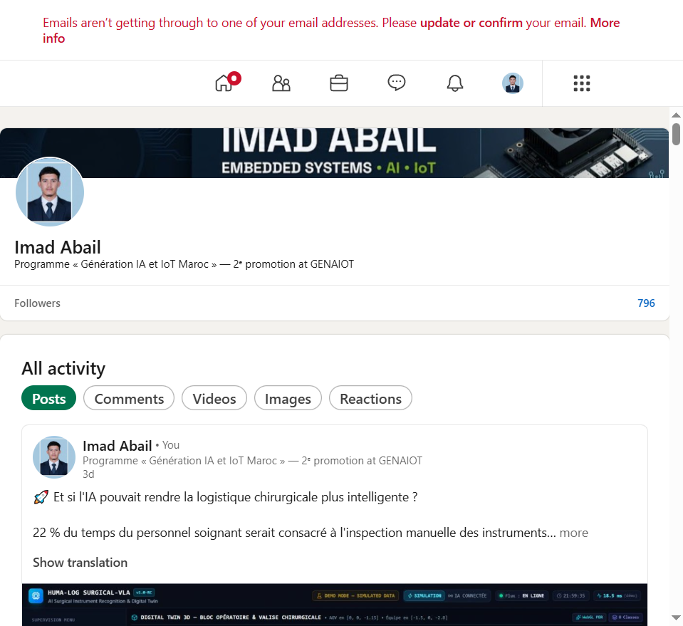
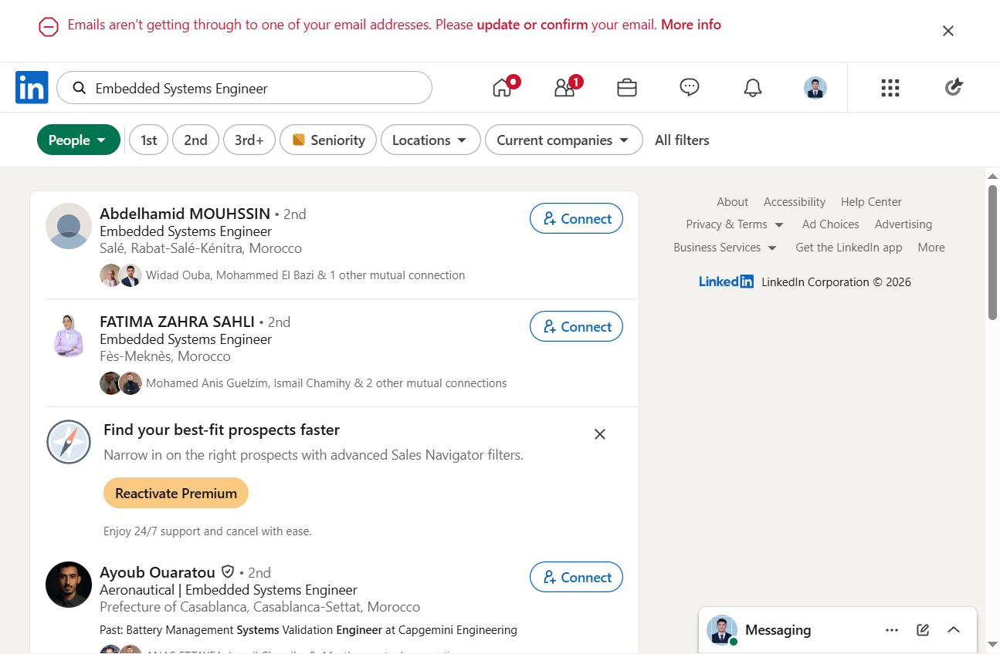
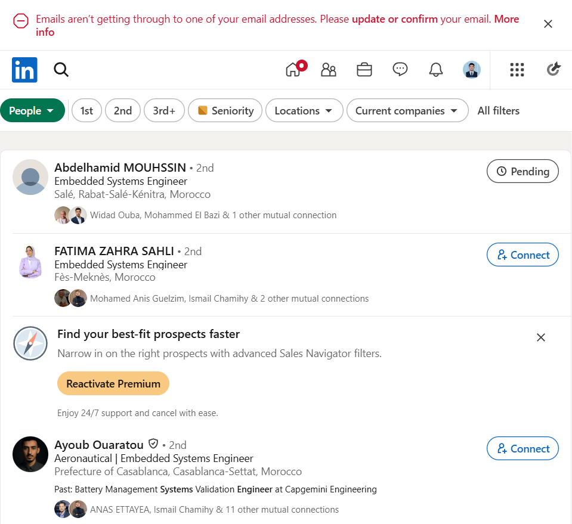
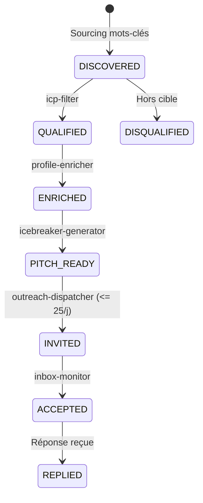

# 🚀 LinkedIn Daily Growth — Antigravity Multi-Skills Agent

[](https://python.org/)
[](https://playwright.dev/)
[](skills/)
[]()
[]()
[](LICENSE)

Pipeline d'automatisation agentique et d'orchestration de croissance B2B sur **LinkedIn**, propulsé par **Google Antigravity** et **12 skills modulaires autonomes**. Le système combine la veille scientifique dynamique (ArXiv, IEEE Spectrum, NVIDIA Research), la génération de contenus techniques à haute valeur ajoutée, et un module d'outreach ciblé protégé par des garde-fous stricts (**Hard-limit 25/jour**, temporisation stochastique, pause week-ends et jours fériés).

---

## 📸 Aperçu & Validation Réelle du Pipeline

| Post Analytique Publié sur LinkedIn (Edge AI / VLA) | Vérification sur Profil & Publications |
| :---: | :---: |
|  |  |
| **Publication automatique en direct** avec mise en forme typographique, crédits et source ArXiv vérifiable. | **Historique des publications validé** sans intervention manuelle sur le compte LinkedIn. |

| Ciblage Chirurgical ICP (Robotique & Embarqué) | Envoi Sécurisé d'Invitations (Safe Quota) |
| :---: | :---: |
|  |  |
| **Sourcing de profils qualifiés** selon des critères stricts (titre, mots-clés, pays, spécialité). | **Envoi d'invitations sans note avec temporisation (90s–180s)** et respect du hard-limit de 25 contacts/jour. |

---

## 🌟 Fonctionnalités Clés

- **Publication Quotidienne Stratégique (8h00 & 12h00)** :
  - **Créneau Matin (08h00)** : Post Analytique / Vision-Language-Action (VLA), Robotique mobile autonome, Edge AI (NVIDIA Jetson, Isaac ROS).
  - **Créneau Midi (12h00)** : Post Cas Pratique / Systèmes Embarqués temps réel, Microcontrôleurs (STM32, ESP32, ARM Cortex-M), Bus de terrain (CAN-FD, Ethernet T1), FreeRTOS.
  - **Médias Riches Associés** : Chaque publication est couplée à une illustration haute résolution et citation de la source primaire.
- **Rotation Dynamique de Veille (Dynamic Content Curator)** :
  - Extraction et rotation automatique d'articles récents (ArXiv, IEEE Xplore, NVIDIA Developer Blog).
  - Prévention de doublons avec cache d'historique de sujets.
- **Outreach Ciblé & Délivrabilité Garantie** :
  - Filtrage ICP multi-critères (titre, mots-clés sectoriels, localisation).
  - Envoi sécurisé via **Chrome DevTools Protocol (CDP)** sur session authentifiée active (aucun identifiant stocké).
  - Machine à états finis pour le suivi des leads : `DISCOVERED` $\rightarrow$ `QUALIFIED` $\rightarrow$ `INVITED` $\rightarrow$ `ACCEPTED` $\rightarrow$ `REPLIED`.
- **Garde-fous de Sécurité & Anti-Ban (Règle P1)** :
  - **Hard-limit strict de 25 contacts maximum par 24h**.
  - **Délai dynamique aléatoire** entre 90 et 180 secondes entre deux actions.
  - **Plage horaire stricte** de 08h00 à 18h00 locale.
- **Détection Automatique Jours Fériés & Week-ends** :
  - Suspension intelligente des publications et invitations les samedis, dimanches et jours fériés officiels pour préserver l'algorithme d'engagement.
- **Recyclage Intelligent de Contenu (Content Repurposing)** :
  - Sauvegarde et réutilisation stratégique des publications à fort engagement après un délai de 60 jours.

---

## 🏗️ Architecture des 12 Skills Antigravity

```mermaid
flowchart TD
    subgraph Prospection & Outreach ICP
        S01["01: icp-filter"] --> S02["02: profile-enricher"]
        S02 --> S03["03: icebreaker-generator"]
        S03 --> S04["04: quota-guardrail"]
        S04 --> S05["05: outreach-dispatcher"]
        S05 --> S11["11: inbox-monitor"]
    end

    subgraph Content Creation & Publishing
        S06["06: content-curator"] --> S07["07: post-copywriter"]
        S07 --> S08["08: visual-generator"]
        S08 --> S09["09: post-scheduler"]
        S09 --> S10["10: engagement-tracker"]
    end

    subgraph Monitoring, Machine d'État & Audit
        S05 -.-> S12["12: daily-reporter"]
        S09 -.-> S12
        S11 -.-> S12
    end
```

| N° | Skill Antigravity | Rôle & Fonctionnalité | Chemin Local |
|:---:|:---|:---|:---|
| **01** | [`icp-filter`](skills/01-icp-filter/SKILL.md) | Filtre les profils selon les critères ICP stricts et déduplique. | `skills/01-icp-filter` |
| **02** | [`profile-enricher`](skills/02-profile-enricher/SKILL.md) | Extrait la bio, les 3 derniers posts et les signaux récents du lead. | `skills/02-profile-enricher` |
| **03** | [`icebreaker-generator`](skills/03-icebreaker-generator/SKILL.md) | Formule une amorce ultra-personnalisée $\le$ 300 caractères. | `skills/03-icebreaker-generator` |
| **04** | [`quota-guardrail`](skills/04-quota-guardrail/SKILL.md) | Impose le hard-limit (25/j) et le délai anti-détection (90-180s). | `skills/04-quota-guardrail` |
| **05** | [`outreach-dispatcher`](skills/05-outreach-dispatcher/SKILL.md) | Exécute la mise en relation sur session connectée Chrome CDP. | `skills/05-outreach-dispatcher` |
| **06** | [`content-curator`](skills/06-content-curator/SKILL.md) | Veille dynamique ArXiv/IEEE avec sources réelles vérifiées. | `skills/06-content-curator` |
| **07** | [`post-copywriter`](skills/07-post-copywriter/SKILL.md) | Rédige les formats 8h (Analytique) et 12h (Cas pratique). | `skills/07-post-copywriter` |
| **08** | [`visual-generator`](skills/08-visual-generator/SKILL.md) | Sélectionne et formate les visuels haute résolution associés. | `skills/08-visual-generator` |
| **09** | [`post-scheduler`](skills/09-post-scheduler/SKILL.md) | Déclenche, valide et journalise la publication aux heures H. | `skills/09-post-scheduler` |
| **10** | [`engagement-tracker`](skills/10-engagement-tracker/SKILL.md) | Analyse les 60 premières minutes pour booster la portée. | `skills/10-engagement-tracker` |
| **11** | [`inbox-monitor`](skills/11-inbox-monitor/SKILL.md) | Détecte les acceptations et pilote la transition de la machine d'état. | `skills/11-inbox-monitor` |
| **12** | [`daily-reporter`](skills/12-daily-reporter/SKILL.md) | Génère le rapport factuel de 18h00 avec métriques clés. | `skills/12-daily-reporter` |

---

## 🚦 Machine à États des Prospects (Lead State Machine)

Les prospects sont gérés par le fichier centralisé [`pipeline/lead_state_machine.json`](pipeline/lead_state_machine.json) :



---

## 🛠️ Installation & Démarrage

### 1. Cloner le projet
```bash
git clone https://github.com/imadabail08-hue/linkedin-growth.git
cd linkedin-growth
```

### 2. Installer les dépendances
```bash
pip install -r requirements.txt
```

### 3. Lancer Chrome en mode Débogage Distant (Port 9222)
Le script pilote directement votre navigateur Chrome déjà connecté à LinkedIn via le port CDP 9222 :
```cmd
"C:\Program Files\Google\Chrome\Application\chrome.exe" --remote-debugging-port=9222 --user-data-dir="C:\Users\Windows 10\chrome-debug-profile" "https://www.linkedin.com"
```

### 4. Lancement Rapide (Script Interactif)
Sous Windows, double-cliquez simplement sur :
```cmd
LANCER_LINKEDIN_GROWTH.bat
```
Ou en ligne de commande :
```bash
# Créneau du matin (08h00) : Post Analytique VLA + 13 connexions
python daily_linkedin_runner.py --slot morning

# Créneau du midi (12h00) : Post Embarqué IoT + 12 connexions
python daily_linkedin_runner.py --slot noon

# Vérifier le calendrier et jours fériés
python holiday_checker.py
```

---

## 🛡️ Respect des Règles & Anti-Ban

1. **Aucun identifiant requis** : Connexion via session active du navigateur hôte (aucun mot de passe ni token sensible requis dans le code).
2. **Hard-Limit Quotidien Strict** : Arrêt systématique à **25 demandes par tranche de 24h**.
3. **Temporisation Stochastique** : Délais aléatoires de 90s à 180s reproduisant un comportement humain.
4. **Plage Active** : Exécution autorisée uniquement entre 08h00 et 18h00 locale.
5. **Mode Repos** : Détection automatique des samedis, dimanches et jours fériés.

---

## 📄 Licence
Projet open-source distribué sous licence [MIT](LICENSE).
