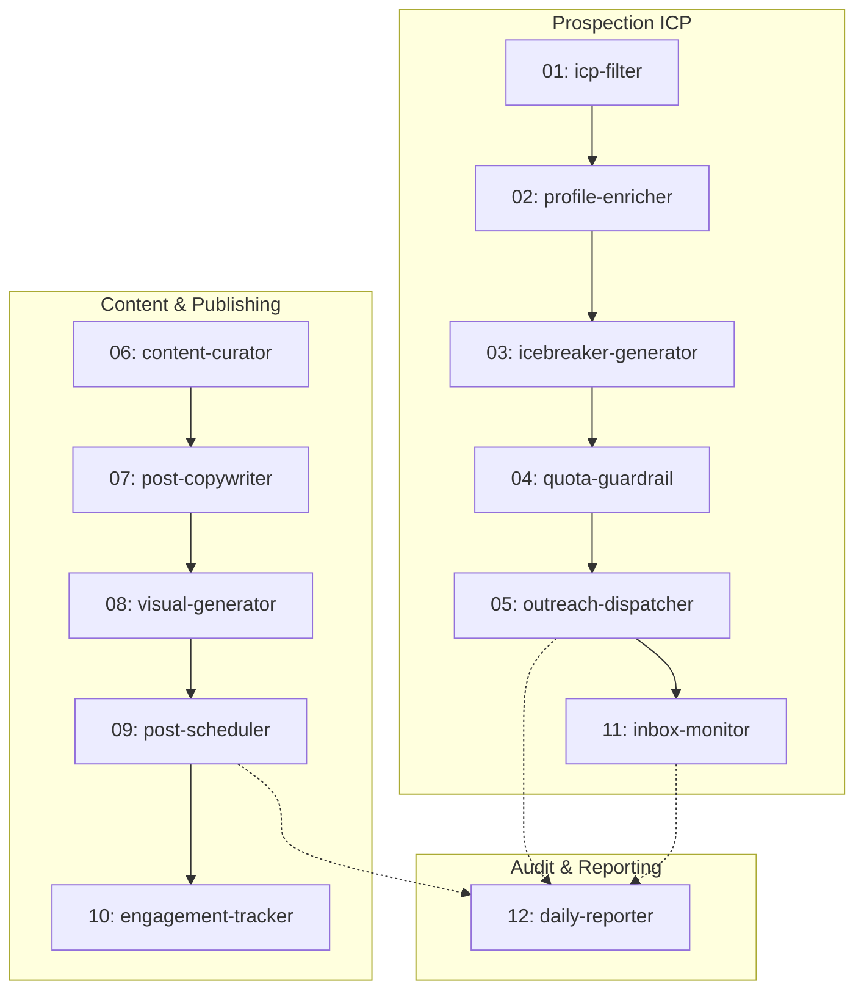

# 🚀 LinkedIn Daily Growth — Antigravity Multi-Skills Agent

Pipeline d'automatisation autonome sous **Google Antigravity** orchestré par **12 skills modulaires** pour la croissance B2B sur LinkedIn.

---

## 🌟 Fonctionnalités Clés

- **Publication Quotidienne Stratégique (8h00 & 12h00)** :
  - **8h00** : Post Analytique / Edge AI & Robotique autonome (modèles VLA, NVIDIA Jetson).
  - **12h00** : Post Cas Pratique / Systèmes Embarqués & IoT Industriel (ARM Cortex-M, CAN-FD, RTOS).
  - **Médias Riches & Sources** : Chaque post inclut une photo haute résolution et la citation vérifiable de sa source (ArXiv, IEEE Spectrum, NVIDIA Research).
- **Rotation Dynamique de Veille (ArXiv & IEEE)** : Récupération automatique des dernières publications sans répétition des sujets.
- **Outreach Ciblé (Quota de Sécurité 25/jour)** :
  - Filtrage ICP strict (ingénieurs embarqués, roboticiens, PhD, experts NVIDIA).
  - Envoi automatique de demandes de connexion sans note.
  - Temporisation anti-détection aléatoire (entre 90 et 180 secondes).
  - Arrêt strict au 25ᵉ contact par jour.
- **Mode Pause Jours Fériés & Week-ends** : Suspension automatique des publications les samedis, dimanches et jours fériés pour optimiser l'engagement.
- **Recyclage Intelligent (Content Repurposing)** : Sauvegarde des publications à fort engagement pour réutilisation après 60 jours.

---

## 🏗️ Architecture des 12 Skills Antigravity



| N° | Skill | Description |
|:---:|:---|:---|
| **01** | `icp-filter` | Filtre les profils scrapés et élimine les doublons. |
| **02** | `profile-enricher` | Extrait les métadonnées et activités récentes du profil. |
| **03** | `icebreaker-generator` | Génère une accroche personnalisée ($\le$ 300 car.). |
| **04** | `quota-guardrail` | Hard-limit 25/jour et temporisation (90-180s). |
| **05** | `outreach-dispatcher` | Envoie la mise en relation via la session Chrome CDP. |
| **06** | `content-curator` | Veille dynamique ArXiv/IEEE/NVIDIA avec sources réelles. |
| **07** | `post-copywriter` | Rédige les formats 8h (Analytique) et 12h (Cas pratique). |
| **08** | `visual-generator` | Génère ou formate les visuels haute résolution. |
| **09** | `post-scheduler` | Déclenche et valide la publication aux créneaux programmés. |
| **10** | `engagement-tracker` | Scrute les interactions durant la première heure. |
| **11** | `inbox-monitor` | Détecte les acceptations et classe les réponses. |
| **12** | `daily-reporter` | Produit le bilan journalier à 18h00 avec métriques `[À mesurer]`. |

---

## 🛠️ Installation & Prérequis

### 1. Cloner le dépôt
```bash
git clone https://github.com/VOTRE_USER/linkedin-daily-growth.git
cd linkedin-daily-growth
```

### 2. Installer les dépendances
```bash
pip install -r requirements.txt
```

### 3. Lancer Chrome en mode Débogage Distant (Port 9222)
```cmd
"C:\Program Files\Google\Chrome\Application\chrome.exe" --remote-debugging-port=9222 --user-data-dir="C:\Users\Windows 10\chrome-debug-profile" "https://www.linkedin.com"
```

### 4. Lancer manuellement un créneau
```bash
# Créneau du matin (8h00)
python daily_linkedin_runner.py --slot morning

# Créneau du midi (12h00)
python daily_linkedin_runner.py --slot noon
```

---

## 🛡️ Règles de Sécurité & Délivrabilité
- **Hard-Limit Quotidien** : 25 contacts maximum par tranche de 24h.
- **Temporisation dynamique** : 90s à 180s entre deux envois d'invitations.
- **Plage horaire stricte** : 08h00 à 18h00 locale.
- **Protection des données** : Zéro stockage de mots de passe en clair (utilisation exclusive de la session navigateur active via Chrome DevTools Protocol).

---

## 📄 Licence
Ce projet est sous licence MIT.
